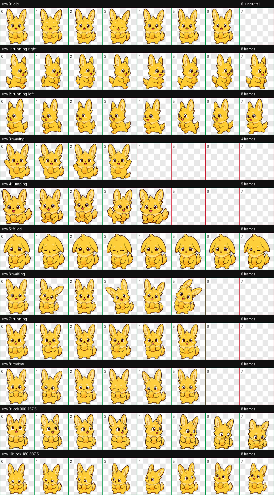
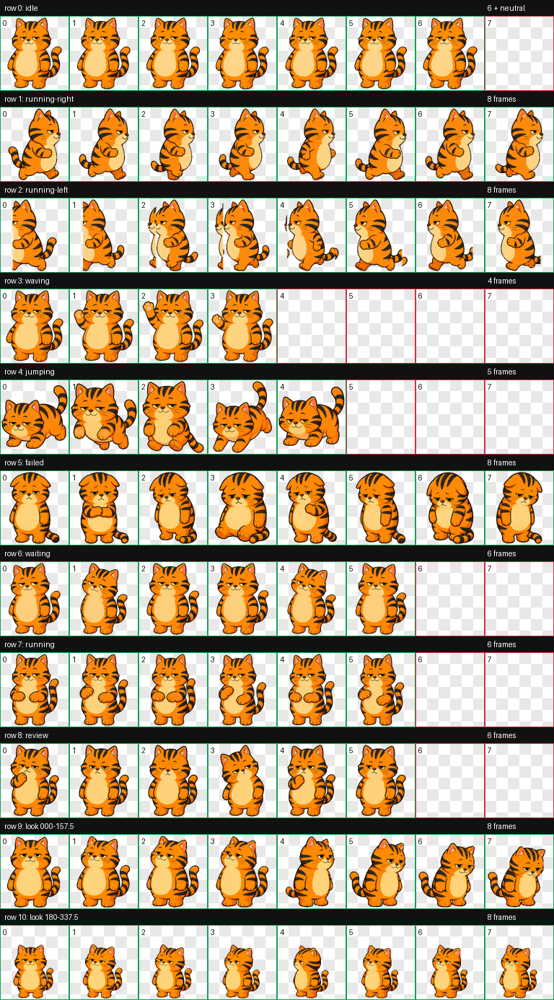

# ChatGPT Pets

Custom animated pets for Codex/ChatGPT.

Each pet is packaged as a Codex-compatible `spriteVersionNumber: 2` atlas:

- `pet.json`
- `spritesheet.webp`
- optional QA artifacts under `qa/<pet-id>/`

## Available Pets

### Voltcoin

Original yellow long-eared assistant pet with a blank gold coin prop. Its active-task animation flips the coin between its paws.

Animation preview:



Install:

```bash
./scripts/install-voltcoin.sh
```

### Marmalade

Original lazy orange tabby assistant pet with sleepy expression and no coin or Bitcoin prop.

Animation preview:



Install:

```bash
./scripts/install-marmalade.sh
```

## Manual Install

Codex looks for custom pets under:

```text
~/.codex/pets/<pet-id>/
```

To install a pet manually:

```bash
mkdir -p ~/.codex/pets/marmalade
cp pets/marmalade/pet.json ~/.codex/pets/marmalade/pet.json
cp pets/marmalade/spritesheet.webp ~/.codex/pets/marmalade/spritesheet.webp
```

Expected structure:

```text
~/.codex/pets/marmalade/
  pet.json
  spritesheet.webp
```

`pet.json` must include:

```json
{
  "id": "marmalade",
  "displayName": "Marmalade",
  "description": "An original lazy orange tabby Codex assistant pet with sleepy charm and no coin prop.",
  "spriteVersionNumber": 2,
  "spritesheetPath": "spritesheet.webp"
}
```

Restart Codex after installing or replacing a pet.

## Create A Custom Pet

Use the Codex `hatch-pet` workflow when creating a new pet. The important constraints are:

- generate an original mascot, not a direct copy of a copyrighted character
- keep the pet readable inside `192x208` cells
- create a final `1536x2288` atlas with 8 columns and 11 rows
- include the 9 standard animation rows plus 16 look-direction cells
- set `spriteVersionNumber: 2` in `pet.json`
- keep text, logos, scenery, shadows, detached effects, and guide marks out of the sprite

Recommended request format:

```text
Create a Codex pet named <Name>.
Style: <short style description>.
References: <links or local image paths>.
Must include: <props/personality/animation notes>.
Must avoid: <logos/text/copyright-sensitive details/props to exclude>.
Add it to this repository with QA artifacts and an install script.
```

Typical output layout:

```text
pets/<pet-id>/
  pet.json
  spritesheet.webp

qa/<pet-id>/
  validation-extended.json
  chroma-despill-extended.json
  contact-sheet-extended.png
  look-directions.png
  direction-semantics.json
  direction-blind-validation.json
  blind-review-resolution.json
  look-continuity.json
  review.json
  run-summary.json

scripts/install-<pet-id>.sh
```

Before adding a pet to the repo, validate at least:

```text
spriteVersionNumber: 2
atlas size: 1536x2288
validate_atlas --require-v2: ok true
chroma despill: ok true
no failed direction semantics
standard rows visually match their state
```

## QA Notes

QA artifacts are stored per pet under `qa/<pet-id>/`.

`Voltcoin` passed deterministic validation and blind direction validation, with reviewed non-blocking warnings.

`Marmalade` passed deterministic atlas validation and labeled direction QA. Independent blind direction QA could not complete because the spawned QA agents hit account usage limits; this is documented in `qa/marmalade/direction-blind-validation.json` and `qa/marmalade/blind-review-resolution.json`.
